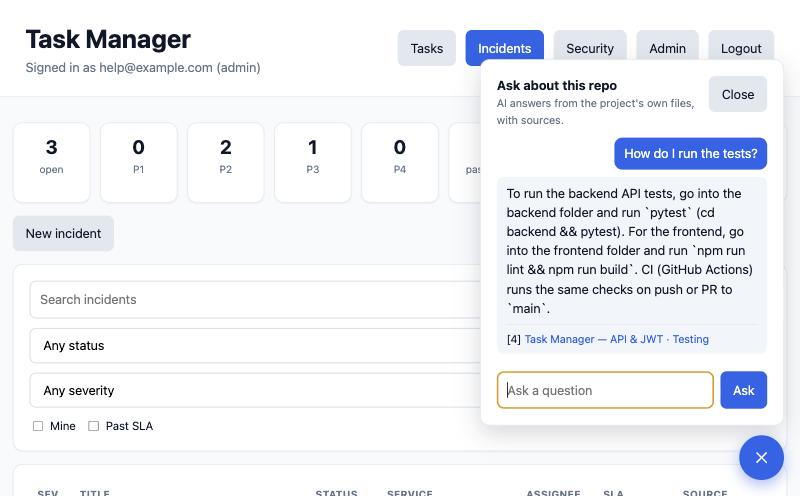

# pagewise: RAG Chat Bot for Websites

Ask questions about a website and get answers **only from its own pages**, each with the pages it came from.
If the site doesn't say, pagewise says so instead of guessing.

It crawls a site, indexes the text, and answers through retrieval plus Claude. The "never guess" rule is enforced
by the code around the model, not just by a line in the prompt.



*pagewise running as the chat bot of a real application, answering from that repository's own files. Claude wrote
the answer, and the link under it is the source.*

## Quickstart

```bash
python3 -m venv .venv && source .venv/bin/activate
pip install -r requirements-dev.txt

python -m pagewise crawl https://ron-shitrit.pages.dev   # download the pages -> data/pages.json
python -m pagewise index                                 # chunk + embed them  -> data/index

export ANTHROPIC_API_KEY=...                             # only needed for ask / chat / serve / eval --live
python -m pagewise ask "What does the CI triage agent do?"
python -m pagewise chat                                  # interactive, in the terminal
python -m pagewise serve                                 # chat page at http://127.0.0.1:8000
```

The repo ships a snapshot of the demo site in `data/pages.json`, so `index` works without crawling.
The first `index` downloads a small embedding model (about 80 MB) that runs locally.

## How a question is answered

1. **Retrieve.** Candidates come from two searches: nearest chunks by meaning (ChromaDB vectors) and best matches by
   exact words (keywords). Each candidate is scored `0.7 * vector similarity + 0.3 * keyword overlap`.
2. **Gate.** If even the best chunk scores below `0.28`, the question is off-topic for this site. pagewise answers
   "I can't answer that from this site's pages." and **never calls the model**.
3. **Judge.** Otherwise Claude receives the top 4 chunks as numbered sources and must return JSON:
   `{answerable, answer, source_ids}`. It is told to use only the sources, to say `answerable: false` when they
   don't contain the answer, and to treat both the sources and the question as untrusted text.
4. **Verify.** The answer is rejected (shown as "couldn't produce a reliable answer") if it cites no source, cites
   an id it wasn't given, or states a number that none of the cited sources contain.
5. **Respond.** The answer comes back with the cited pages: title, section and link.

If the model is unavailable, refuses, runs out of tokens or returns something unreadable, the visitor gets a visible
"couldn't produce a reliable answer" message, never silence and never a guess.

## Guards, and what each one is for

| Guard | Where | Stops |
|---|---|---|
| Not-covered gate | `retrieve.py`, `answer.py` | Off-topic questions reaching the model (and costing money) |
| "Answerable" flag + strict system prompt | `llm.py` | Answering from outside knowledge |
| Citation check | `answer.py` | Answers with no source, or invented source ids |
| Number check | `answer.py` | Invented figures, prices, dates |
| Untrusted-text rule | `llm.py` | Instructions hidden in page text or in the question |
| Question length limit, per-IP rate limit | `server.py` | Abuse of a public endpoint that spends API credit |
| `textContent` only in the chat page | `web/index.html` | Answers being interpreted as HTML |

## Evaluation

`evals/golden.json` holds 28 questions about the demo site (a second file, `evals/golden_argocd.json`, covers a different site, see below): 18 answerable from one page, 6 off-topic (must be
refused before the model), 4 on-topic but not on the site (the model must decline).

```bash
python -m pagewise eval          # offline: retrieval + gate, no API key needed (this runs in CI)
python -m pagewise eval --live   # full pipeline with Claude: right page cited, expected facts present, refusals honoured
```

**What is measured:** offline, 28/28 pass. For the 18 answerable questions the right page is in the top 4, and every
off-topic question scores at most 0.21 against a gate of 0.28, while the weakest answerable one scores 0.43.

<!-- TODO(live-eval): after running `python -m pagewise eval --live` (needs ANTHROPIC_API_KEY), add the result here and
     update the "not measured yet" list below. Paste the numbers exactly as the run printed them, for example:

     **Live result (YYYY-MM-DD, claude-sonnet-5-5):** N/18 answerable questions answered with the right page cited and the
     expected facts, N/10 off-topic or uncovered questions refused. Estimated cost: $X.XXXX total, $0.00XX per answered question.
-->

**What is not measured yet:**
- **The live eval has not been run.** The tests exercise the request and the answer checks with a fake model, so the
  shape of the call and every refusal path is covered. I have also used the pipeline with the real model on a second
  corpus (a code repository) and it answered correctly, but those were spot checks and are not scored. Accuracy with
  Claude is not measured until `pagewise eval --live` has been run.
- The gate threshold was tuned on the same 28 questions it is scored on. Treat 28/28 as "works on the demo set", not as
  a general accuracy figure.
- Only three sources have been tried: a small portfolio site and the Argo CD docs (both offline, retrieval only) and a code repository (the only one used with the real model, as spot checks).

### A third corpus: the Argo CD documentation

To check that pagewise is not tuned to one site, I ran it on a site it was never built or tuned for: the public Argo CD docs
(Apache-2.0, `robots.txt` allows crawling). `evals/golden_argocd.json` holds 23 questions written *before* the first
run, each checked against the page text: 17 answerable from one page, 3 off-topic, and 3 that sound on-topic but the docs do
not cover (pricing, a phone number, Nomad; I confirmed none of those words appear in the crawled pages).

```bash
python -m pagewise crawl https://argo-cd.readthedocs.io/en/stable/ --under-start-path --exclude /snyk/ --max-pages 600 --out data/argocd/pages.json
python -m pagewise index --pages data/argocd/pages.json --index data/argocd/index
python -m pagewise eval --index data/argocd/index --golden evals/golden_argocd.json      # offline; add --live to call Claude
```

I did not commit the crawled pages (they are someone else's documentation); the crawl above reproduces them. The docs change
over time, so a later crawl can score differently. Crawled 2026-11-10: 456 pages, 4,266 chunks, indexed in about 30 seconds.
The crawl skips `/snyk/` because 88% of that site's text (18.5 of 21 million characters) is generated vulnerability reports, not documentation.

**Result with the default settings, no tuning: 20 of 23 pass offline.**

| | |
|---|---|
| Off-topic questions refused before the model | 3 of 3 (they scored at most 0.17 against the 0.28 gate) |
| Answerable questions where the right page was in the top 4 | 14 of 17 |
| On-topic but not covered by the docs | not checked offline: they scored 0.49 to 0.71, far above the gate, so only the model can refuse them |

The three misses, and what they actually are:
- **"What are the main components in the Argo CD architecture?"** Retrieval returned `developer-guide/architecture/components`, a page
  about exactly that. The docs have several architecture pages and my question named only one, so this is partly a question that was
  too narrow. I counted it as a miss anyway and did not edit the golden file.
- **"How do I shard clusters across application controller replicas?"** The top five results were all from a design *proposal*
  page about dynamic rebalancing, which repeats the question's words; the guide that answers it ranked 12th. This is a real weakness.
- **"Can the default AppProject be deleted?"** Retrieval matched the word "deleted" and returned deletion pages. The answer is
  one short sentence on the projects page, which ranked 7th. Also a real weakness.

The live eval has not been run on this corpus either, so none of this says how well Claude answers: it only measures whether the
right page is found. Findings worth acting on: down-weight design proposals against guides, and give very short sections more weight.

## Cost

Every answer carries what it cost: the number of model calls, the tokens, and an estimated dollar figure.

- A question refused before the model (off-topic) makes **no call and costs nothing**.
- A normal answer is one call. If the answer checks fail, the one corrective retry adds a second call, and its cost is added.
- A call that fails or is declined can still use tokens, and those are counted too.
- `pagewise ask` prints a line such as `(1 model call(s), 1843 tokens in, 96 out, about $0.0046)`, the web API returns
  `usage` and `cost_usd` with each answer, and `pagewise eval --live` prints a total and the average per answered question.
- The dollar figure is an **estimate** from the prices in `PRICES` in `pagewise/config.py` (USD per million tokens). Check
  the provider's current price list before quoting it, and add a model to `PRICES` to price it. A model that isn't listed
  reports tokens but no dollar figure.

Cost per answer depends on the model (`PAGEWISE_MODEL`), how many passages are sent (`PAGEWISE_TOP_K`) and the effort setting
(`PAGEWISE_EFFORT`). Measured cost per answer: not published yet, because it comes from the live eval run.

## Known limits

- On a large docs site, design proposals and pages that repeat the question's words can outrank the guide that answers it
  (see the Argo CD results above).
- The "not covered" gate catches off-topic questions, not on-topic ones the site does not answer: those score high on retrieval,
  so only the model can refuse them. The live eval is what measures that.
- Retrieval can miss when a page's text is only an unlabeled list. "What technologies does Ron work with?" finds the
  skills list; "what is Ron's tech stack?" does not.
- Keyword search scans every chunk on each question. That is fine for a site of hundreds of pages, not for a huge corpus.
- It reads static HTML. Pages that only exist after JavaScript runs are not crawled.
- Each question is answered on its own: no memory of the conversation.
- The rate limit is in memory, per process.
- The default model is `claude-sonnet-5-5`. Set `PAGEWISE_MODEL` to try another one (for example `claude-opus-5-5`), and re-run the live eval after
  changing it.

## Configuration

| Variable | Default | Meaning |
|---|---|---|
| `ANTHROPIC_API_KEY` | | Needed for ask, chat, serve and `eval --live` |
| `PAGEWISE_MODEL` | `claude-sonnet-5-5` | Model that writes the answer |
| `PAGEWISE_EFFORT` | `medium` | Model effort level |
| `PAGEWISE_MIN_SCORE` | `0.28` | The not-covered gate |
| `PAGEWISE_RATE_LIMIT` | `10` | Questions per IP per minute on the web server |
| `PAGEWISE_CORS_ORIGINS` | none | Comma-separated origins allowed to call the API from a browser |
| `PAGEWISE_FALLBACKS` | off | Set to `1` to opt into server-side refusal fallback |
| `PAGEWISE_TOP_K` | `4` | How many passages are sent to the model |
| `PAGEWISE_SOURCE_NAME` | `this site's pages` | How refusals name the source, e.g. `the project docs` |
| `PAGEWISE_EXAMPLES` | portfolio examples | Example questions on the chat page, separated by `\|` |
| `PAGEWISE_DATA_DIR` | `data` | Where pages and the index live |
| `PAGEWISE_EMBEDDER` | local model | `hash` uses a tiny offline embedder (tests and smoke runs) |

## Using it on documentation, in Docker

pagewise can read a project folder instead of crawling a site, and it ships a Dockerfile, so it can run as the chat
bot of another project. By default it reads the Markdown files (one page each). With `--code` (or
`PAGEWISE_DOCS_CODE=1` in Docker) it also reads code and config files in windows of about 30 lines, and a citation links
to the exact lines (`...#L10-L40`). Only an allowlist of file types is read (Python, JS, YAML, Terraform, shell, Dockerfiles,
config), and anything that looks like a secret is skipped by name: `.env*`, keys and certificates, `*.tfvars`,
`*.tfstate`, lockfiles. Template files such as `env.example` are read.

```bash
python -m pagewise docs ./my-project --base-url https://github.com/me/my-project/blob/main --code
python -m pagewise index
```

```bash
docker build -t pagewise .
docker run -p 8010:8000 -e ANTHROPIC_API_KEY \
  -e PAGEWISE_DOCS_DIR=/docs -e PAGEWISE_DOCS_CODE=1 \
  -e PAGEWISE_DOCS_BASE_URL=https://github.com/me/my-project/blob/main \
  -v "$PWD/my-project:/docs:ro" pagewise
```

The entrypoint builds the index when the container starts, then serves the chat page and `POST /api/ask`. Citations
link to `--base-url` plus the file path. The chat page uses relative URLs, so it also works behind a proxy path such
as `/assistant/`. A working example is the Task Manager app's `docker-compose.yml`
(`github.com/ron1120/task-manager-infrastructure`), where it is the `pagewise` service.

## Crawling politely

The crawler honours `robots.txt`, stays on one host, identifies itself with a `pagewise` user agent, waits between
requests, follows the sitemap when there is one, and stops at `--max-pages`.

## Layout

```
pagewise/crawl.py      fetch pages, extract readable text grouped under headings
pagewise/docs.py       read Markdown files as pages (for documentation)
pagewise/chunk.py      split into small chunks that remember their page and section
pagewise/store.py      ChromaDB index + swappable embedders
pagewise/retrieve.py   hybrid search, scoring and the not-covered gate
pagewise/llm.py        the Claude call: structured JSON verdict
pagewise/answer.py     the pipeline and its verification checks
pagewise/evals.py      golden-question runner (offline and live)
pagewise/server.py     FastAPI app, rate limit, chat page
pagewise/cli.py        crawl, docs, index, ask, chat, serve, eval
evals/golden.json      the 28 golden questions
tests/                 79 offline tests (fake site, fake model, no network)
```

## Roadmap

1. Run and publish the live eval, then pick the cheapest model that holds it.
2. Streaming answers in the chat page.
3. Conversation memory for follow-up questions.
4. Incremental re-crawl of only changed pages.
5. A second sample site, to show it is not tuned to one.
